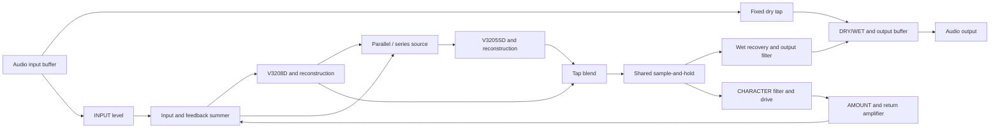

# ZanGei — 8HP analog BBD delay

ZanGei is a compact DIY Eurorack bucket-brigade delay, inspired by the [Erica Synths EDU BBD project](https://www.ericasynths.lv/shop/diy-kits-1/edu-diy-bbd/). Two stacked PCBs make room for two different delay chips, shared clocking and a feedback path with its own character. The goal is **character over fidelity**.

The name is a poetic nod to **残心 (*zanshin*)** in iaido and other martial arts: awareness that remains after an action. It carries that idea into sound as **残韻**—“lingering resonance,” like a bell still ringing after the strike, or an echo carrying something of the past. **ZanGei** is a coined project name, not a standard Japanese reading of those kanji.

**Prototype, not a finished kit:** the complete module has not yet been assembled, calibrated or hardware-qualified. Delay/flanger/chorus behaviour is the design intent, not a measured performance specification.

## What it does

- Mono analog audio path using **V3208D (2048 stages)** and **V3205SD (4096 stages)**.
- Parallel/series input routing for the second BBD, with a blend between the two delay branches.
- Shared CD4046 clock with TC4428AEPA driver, TIME CV and INHIBIT CV.
- Feedback CHARACTER combines pre-filtering and drive; AMOUNT controls the return level.
- Independent dry tap, final DRY/WET blend and SOFT/OFF/DARK wet-output filtering.
- **8HP / 3U**, with two **37.5 × 110 mm** PCBs; requires **±12 V and bus +5 V** through a 16-pin cable.

## Signal path

## Open and explore

Open **[`schematics/BBD_Buffer.kicad_pro`](schematics/BBD_Buffer.kicad_pro)** in **KiCad 10**. Its root schematic links seven electrical sheets; the PCB contains CORE and CONTROL side by side for editing, not one wide finished board. Project-local symbols, footprints and component models are included; KiCad's standard libraries are also required.

- [Architecture and controls](docs/ARCHITECTURE.md)
- [Prototype build, power, stack and fabrication notes](docs/BUILD.md)
- [One-module BOM](bom/v0.1/BOM.md), [grouped CSV](bom/v0.1/BOM_GROUPED.csv) and [per-reference CSV](bom/v0.1/BOM_PER_REFERENCE.csv)
- [Assembly access and sequencing](schematics/assembly/README.md) and [routing limitations](schematics/routing/README.md)
- [Panel source and printable fit prototype](mechanical/README.md)
- [Component datasheets](docs/datasheets/README.md)

The native KiCad files define the implemented circuit. Documentation and 3D envelopes do not certify physical fit or safe operation. Existing assembly/silkscreen findings, clock timing, power bring-up and complete-module performance remain prototype checks. Do not connect an unverified assembly directly to a valuable rack.

## Repository

| Directory | Purpose |
|---|---|
| `schematics/` | Main KiCad design, custom libraries, component models and review records |
| `docs/` | Self-contained architecture, build notes and datasheets |
| `bom/v0.1/` | One-module parts and additional assembly hardware |
| `mechanical/` | Editable panel source and panel exports |
| `simulation/` | Retained circuit studies; not complete-module validation |
| `test_signals/` | Audio used for listening experiments |

The BOM covers 157 schematic positions plus separate sockets and hardware. Generated manufacturing files and full-board FreeCAD review assemblies are local working artifacts, not a fabrication release. See the [simulation guide](simulation/README.md) for the historical scope and requirements of the retained studies.

## Licence and attribution

Project-authored schematics, PCB layouts, mechanical designs, scripts and documentation are [MIT-licensed](LICENSE), including permission to manufacture and sell hardware from the project-authored designs. See [licensing scope and third-party exceptions](docs/LICENSING.md). Third-party datasheets, library assets and simulation models retain their own notices and terms. This is an independent, AI-assisted DIY project, not an official Erica Synths, Coolaudio or other manufacturer's product.
